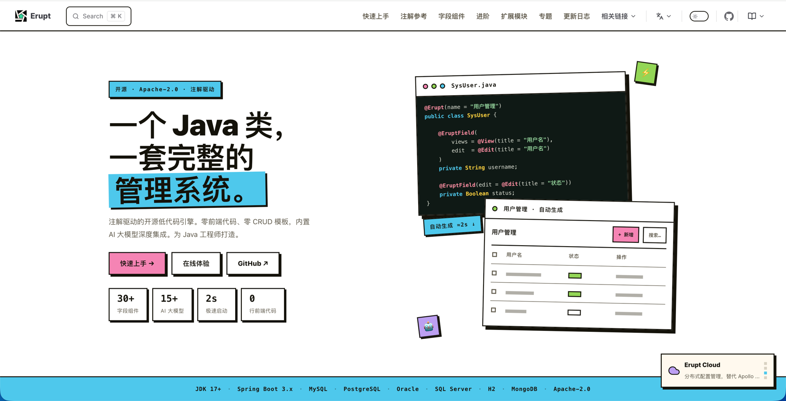
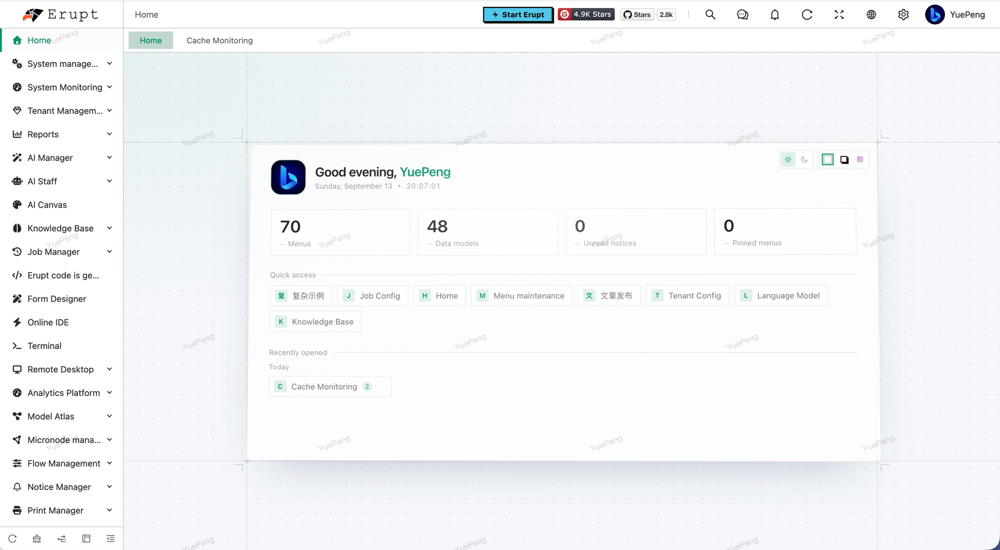
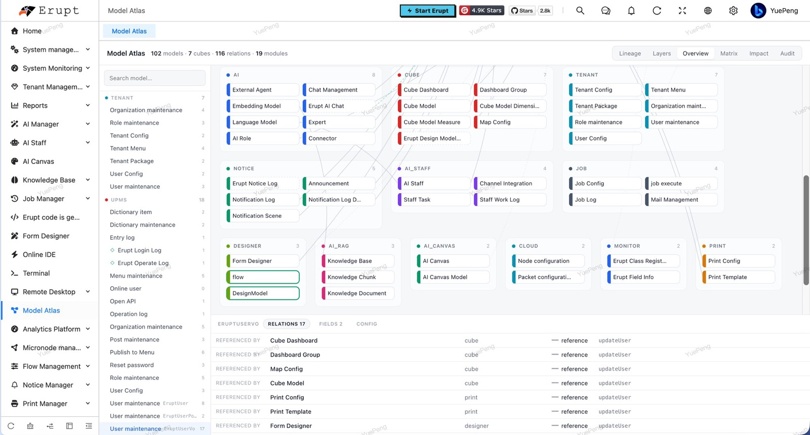
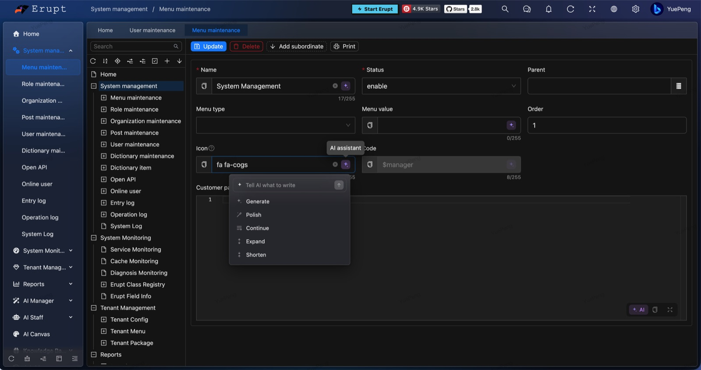
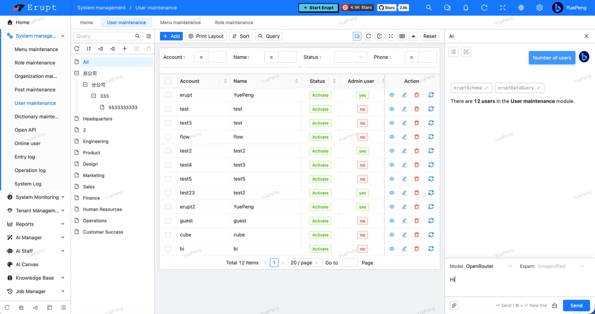
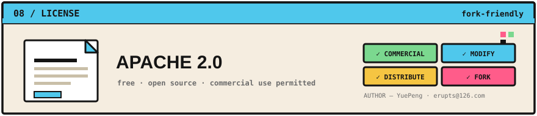

中文 &nbsp;|&nbsp; [English](README.md)

---

<p align="center">
  <picture>
    <source media="(prefers-color-scheme: dark)" srcset="readme/logo2.svg">
    
  </picture>
</p>

<h1 align="center">ERUPT</h1>

<h3 align="center">写一个 Java 类，得到一套完整的管理后台。</h3>

<p align="center">注解驱动的 Java 管理后台框架，内置 AI Harness。<br/>不写 Controller，不写前端，不搭脚手架，2~5 秒启动。</p>

<p align="center">
  <a href="https://mvnrepository.com/search?q=erupt"></a>
  <a href="https://adoptium.net"></a>
  <a href="./LICENSE"></a>
  <a href="https://github.com/erupts/erupt"></a>
  <a href="https://github.com/erupts/erupt/releases"></a>
  <a href="https://github.com/erupts/erupt/actions/workflows/maven.yml"></a>
  <a href="https://app.codecov.io/github/erupts/erupt"></a>
  <a href="https://hub.docker.com/r/erupts/erupt"></a>
  <a href="https://gitee.com/erupt/erupt"></a>
</p>

<p align="center">
  <a href="https://demo.erupt.xyz"><code><b>[ 在线体验 ]</b></code></a>&nbsp;&nbsp;
  <a href="#01--快速开始"><code><b>[ 30 秒上手 ]</b></code></a>&nbsp;&nbsp;
  <a href="https://docs.erupt.xyz"><code><b>[ 文档 ]</b></code></a>&nbsp;&nbsp;
  <a href="https://start.erupt.xyz"><code><b>[ 创建项目 ]</b></code></a>&nbsp;&nbsp;
  <a href="https://skill.erupt.xyz"><code><b>[ AI 技能 ]</b></code></a>&nbsp;&nbsp;
  <a href="https://www.erupt.xyz"><code><b>[ 官网 ]</b></code></a>
</p>

<p align="center"><sub>如果 Erupt 帮你省下了一周的 CRUD，点一个 <a href="https://github.com/erupts/erupt/stargazers">⭐ Star</a>，让下一个 Java 开发者更容易找到它。</sub></p>

<p align="center"></p>

---

## 00 · 30 秒看懂

**这一个类：**

```java
@Erupt(name = "Product", power = @Power(importable = true, export = true))
@Entity
public class Product extends BaseModel {

    @EruptField(views = @View(title = "Name"),
                edit  = @Edit(title = "Name", notNull = true, search = @Search))
    private String name;

    @EruptField(views = @View(title = "Price"),
                edit  = @Edit(title = "Price", search = @Search))
    private BigDecimal price;

    @EruptField(views = @View(title = "Launched"),
                edit  = @Edit(title = "Launched", search = @Search))
    private Date launchDate;
}
```

**……就是整个功能。** 没有 Controller、Service、DTO，也没有 Vue/React 页面。运行后直接得到：

`分页表格` · `搜索表单` · `新增 / 编辑 / 删除` · `校验` · `EXCEL 导入导出` · `角色权限` · `操作日志` · `带权限的 REST API` · `文本字段 AI 写作助手`

加一个字段，刷新页面，它就出现了。

| 手写一个后台页面 | 用 Erupt 写同一个页面 |
|---|---|
| Entity + Repository + Service + Controller + DTO | 一个带注解的实体类 |
| 前端页面、表单、表格、路由、构建流水线 | 运行时由注解渲染 |
| 每个接口手动接入权限校验 | 用户、角色、菜单、行列权限内置 |
| Excel、日志、搜索、分页每次重写 | 默认开启，按实体开关 |
| 每张表重复一遍 | 每张表也重复一遍 —— 只要几行 |

> 实体仍是标准 JPA。去掉注解，领域模型照样编译运行 —— 没有锁定。

---

## 01 · 快速开始

**最快 —— Docker，零配置：**

```bash
docker run -p 8080:8080 erupts/erupt
# → http://localhost:8080   账号：erupt / erupt
```

全家桶镜像，内置 designer、job、monitor、magic-api、notice、AI、cloud-server 与内嵌 H2。生产环境切换 MySQL / Redis 见 [镜像使用说明 →](./erupt-deploy/erupt-docker/README.md)

**接入已有 Spring Boot 项目 —— 一个依赖：**

```xml
<dependency>
    <groupId>xyz.erupt</groupId>
    <artifactId>erupt-spring-boot-starter</artifactId>
    <version>${erupt.version}</version>
</dependency>
```

照上面的样子写一个实体，执行 `mvn spring-boot:run`，打开 `http://localhost:8080`（`erupt / erupt`）。需要全部可选模块（designer、job、generator、monitor、magic-api、websocket、notice、print、terminal、AI、cloud-server）？改用 `erupt-spring-boot-starter-all`。

<details>
<summary><b>更多上手方式 —— 源码、在线脚手架、AI 技能、免安装体验</b></summary>

**源码运行** —— H2 内存库，无需配置：

```bash
git clone https://github.com/erupts/erupt.git
cd erupt
mvn spring-boot:run -pl erupt-sample -am
```

**在线脚手架** —— [start.erupt.xyz](https://start.erupt.xyz)：浏览器里勾选模块，下载即可运行的项目。

**AI 技能** —— [skill.erupt.xyz](https://skill.erupt.xyz)：在 Claude Code 等 AI Agent 中用一句话描述系统，得到一个可运行的后台 —— JDK、H2、登录、增删改查、搜索、Excel、权限全部包含。只生成实体类，Token 消耗约为生成全栈代码的 1/20。非技术岗位（运营、HR、产品、财务）也能用。

```bash
git clone https://github.com/plinian/erupt-skill.git ~/.claude/skills/erupt-admin
# 然后对 Claude Code 说："帮我做一个 CRM 管理后台"
```

**免安装** —— [demo.erupt.xyz](https://demo.erupt.xyz)（`guest / guest`）· **完整指南** —— [docs.erupt.xyz/guide/quick-start](https://docs.erupt.xyz/guide/quick-start)

</details>

---

## 02 · 为什么开发者选 ERUPT

| | |
|---|---|
| `一个类 = 一个页面` | 表格、表单、树、卡片、甘特图，以及日期、滑块、代码编辑器、引用表、地图、签名、Markdown 等 30+ 字段组件，全部由 `@View` / `@Edit` / `@Search` 驱动。 |
| `快` | Java 17 + Spring Boot 3。从启动到可用界面 2~5 秒，无需前端构建。 |
| `默认安全` | RBAC、菜单、行级过滤（SpEL）、列可见性、OAuth2 / LDAP / SSO、操作日志。REST API 与界面遵循同一套规则。 |
| `任意数据源` | JPA 支持 MySQL · PostgreSQL · Oracle · SQL Server · 达梦，另有 MongoDB、JDBC、HTTP、Elasticsearch、Redis、S3、LDAP、Kubernetes、文件、飞书、钉钉、Notion、Airtable 连接器。 |
| `AI 原生` | 50+ 大模型、MCP 工具、A2A 多智能体、按角色授权工具 —— 在后台界面配置，不改代码。 |
| `随时可扩展` | `DataProxy` 生命周期钩子、自定义行操作、choice / filter / power 处理器、类型安全的 `LambdaQuery`、模板自定义页面。 |
| `永久免费` | 核心 Apache 2.0。不限项目数，不限商用。 |

<details>
<summary><b>再看点代码 —— 滑块、下拉选择、自定义操作、LambdaQuery</b></summary>

```java
@Erupt(
    name = "Simple",
    power = @Power(importable = true, export = true),
    rowOperation = @RowOperation(
        title = "Custom Action",
        mode = RowOperation.Mode.SINGLE,
        operationHandler = OperationHandlerImpl.class
    )
)
@Table(name = "t_simple")
@Entity
public class Simple extends BaseModel {

    @EruptField(
        views = @View(title = "Slider"),
        edit  = @Edit(title = "Slider", type = EditType.SLIDER, search = @Search,
            sliderType = @SliderType(max = 90, markPoints = {0, 30, 60, 90}, dots = true))
    )
    private Integer slide;

    @EruptField(
        views = @View(title = "Choice"),
        edit  = @Edit(title = "Choice", type = EditType.CHOICE, search = @Search,
            choiceType = @ChoiceType(
                fetchHandler = SqlChoiceFetchHandler.class,
                fetchHandlerParams = "select id, name from e_upms_menu"
            ))
    )
    private Long choice;
}
```

类型安全的查询，告别字符串：

```java
List<EruptUser> list = eruptDao.lambdaQuery(EruptUser.class)
        .like(EruptUser::getName, "e")
        .isNull(EruptUser::getWhiteIp)
        .in(EruptUser::getId, 1, 2, 3, 4)
        .ge(EruptUser::getCreateTime, "2023-01-01")
        .list();
```

更多场景 —— [erupt.xyz/#!/contrast](https://www.erupt.xyz/#!/contrast)

</details>

---

## 03 · 开箱即用

<p align="center"></p>

| | |
|---|---|
| `界面生成` | 表格、表单、搜索、分页、树、卡片、甘特图，全部来自注解。 |
| `UPMS` | 用户、角色、菜单、组织、岗位、字典、行列权限、操作日志。 |
| `OPENAPI` | 每个 `@Erupt` 实体都是 REST 接口，与界面共用权限规则。 |
| `EXCEL` | 通过 `erupt-excel` 导入导出，可在 `DataProxy` 中覆写。 |
| `插件` | 报表、设计器、定时任务、代码生成、监控、magic-api、通知、打印、终端、评论、版本记录、Webhook、SSO、文件中心、配置中心。 |
| `模型图谱` | 由同一套注解绘制的全部模型与关系 —— 总览、分层、血缘、影响面、权限审计。 |

<table>
  <tr>
    <td width="50%"></td>
    <td width="50%"></td>
  </tr>
</table>

模块目录 —— [erupt.xyz/#!/module](https://www.erupt.xyz/#!/module) · API 文档 —— [javadoc.erupt.xyz](https://javadoc.erupt.xyz)

---

## 04 · AI HARNESS

> 把 AI 送上生产，光有 SDK 不够：**治理**（RBAC）+ **互通**（MCP、A2A）+ **可观测**（会话历史、Token 统计）+ **运维友好的配置**（后台界面）。`erupt-ai` 四样全给。

**模型厂商** —— OpenAI · Claude · Gemini · DeepSeek · 通义千问 · 智谱 GLM · 豆包 · Moonshot · MiniMax · Mistral · Grok · Fireworks · Together · OpenRouter · Ollama —— 后台界面热切换，共 50+。

任意 Spring Bean 一键变成 AI 工具：

```java
@AiToolbox
@Component
public class OrderTools {

    @Tool("Look up order status by order ID")
    public String getOrderStatus(String orderId) {
        return orderService.getStatus(orderId);
    }
}
```

| | |
|---|---|
| `MCP · A2A` | 接入任意 MCP 工具服务（SSE / STDIO），自带健康检查。智能体之间通过 A2A 互相调用。 |
| `工具安全` | 每个工具受 `LLMRole` 管控，运行时按角色授权或回收，无需重启。 |
| `流式 · 思考模型` | SSE 逐 Token 输出，原生支持推理模型。 |
| `记忆` | 按用户的会话历史、Token 统计、跨会话长期记忆。 |
| `字段助手` | 所有生成表单中的文本字段都带生成 / 润色 / 续写 / 扩写 / 缩写，流式写入，一键撤销。 |
| `AI CLAW` | `erupt-ai-claw` —— 用自然语言操作实体、Shell、文件和浏览器，兼容 [skills.sh](https://skills.sh) 上 70 万+ 技能。 |

<table>
  <tr>
    <td width="50%"></td>
    <td width="50%"></td>
  </tr>
</table>

> `选哪个 AI 模块？` —— 想自己搭 Agent、直接用 LLM / MCP，选 `erupt-ai`；想要开箱即用的后台智能体，选 `erupt-ai-claw`（它依赖 `erupt-ai`，只需引入这一个）。

---

## 05 · CLOUD —— 一个控制台，管理众多服务

> `erupt-cloud` 把同一套 `@Erupt` 模型带到分布式部署：中心控制台管理配置、节点与拓扑，每个服务内都有自己的管理后台。

```
┌────────────────────────────┐
│  erupt-cloud-server        │   中心控制台
│  config · nodes · topology │
└──────────────┬─────────────┘
               │  注册 / 拉取配置
   ┌───────────┼───────────┐
   ▼           ▼           ▼
┌───────┐  ┌───────┐  ┌───────┐
│ node  │  │ node  │  │ node  │   erupt-cloud-node
│ + own │  │ + own │  │ + own │   每个服务自带后台
│ admin │  │ admin │  │ admin │
└───────┘  └───────┘  └───────┘
```

节点可运行在 Spring Boot 上，也可脱离 Spring 运行在 Solon、Quarkus、Micronaut、Vert.x、Ktor 和原生 Servlet 上；非 Java 服务通过 [erupt-sdk](https://github.com/erupt-io/erupt-sdk) 接入。配置变更全程留痕，回滚粒度细于版本级。

[docs.erupt.xyz/modules/erupt-cloud](https://docs.erupt.xyz/modules/erupt-cloud) · [erupt.xyz/#!/cloud](https://www.erupt.xyz/#!/cloud)

---

## 06 · 常见问题

<details>
<summary><b>商用真的免费吗？</b></summary>

是的。核心模块（`erupt-core`、`erupt-annotation`、`erupt-web`、`erupt-jpa`、`erupt-upms`、`erupt-ai` 等）永久 Apache 2.0 —— 不限项目数，不限商用。见 [治理承诺](./.github/GOVERNANCE.md)。

</details>

<details>
<summary><b>注解满足不了需求怎么办？</b></summary>

用 `DataProxy` 介入每个阶段（新增 / 修改 / 删除 / 查询 / 搜索 / 导入 / 导出的前后），加自定义行操作与处理器，用 `LambdaQuery` 查询，再通过模板引擎（Ant Design、Element UI、Element Plus）嵌入自己的页面。

</details>

<details>
<summary><b>会被框架锁定吗？</b></summary>

不会。实体就是标准 JPA 类，注解只描述界面；去掉注解，领域模型仍可被任何 Spring Boot 代码使用。

</details>

<details>
<summary><b>支持哪些数据库和 Java 版本？</b></summary>

Java 17+、Spring Boot 3。JPA 支持 MySQL、PostgreSQL、Oracle、SQL Server、达梦、H2；MongoDB 等十余种数据源通过 `erupt-data` 连接器接入。

</details>

---

## 07 · 商业模块

可选的企业级扩展，与免费核心独立演进。

| 模块 | 场景 | 文档 |
|---|---|---|
| `ERUPT FLOW` | 工作流 / 审批引擎 | [文档 →](https://docs.erupt.xyz/modules/pro/erupt-flow) |
| `ERUPT SAAS` | 多租户基础设施 | [文档 →](https://docs.erupt.xyz/modules/pro/erupt-tenant) |
| `ERUPT CUBE` | 带语义层的 BI 平台 | [文档 →](https://docs.erupt.xyz/modules/pro/erupt-cube) |

源码交付 · 一次购买 · 永久使用 —— **[价格与购买 →](https://www.erupt.xyz/?utm_source=github&utm_medium=readme&utm_campaign=pro#!/pro)**

---

## 08 · 匿名统计

Erupt 会上报匿名使用统计 —— erupt 版本、已安装模块、JDK、操作系统与数据库类型、Spring Boot 版本、时区 —— 用于指导兼容性与路线图决策。绝不发送业务数据、凭据、主机名或任何由 IP 推导的信息，请求失败静默处理，不会阻塞启动。

通过 `erupt.telemetry.enabled: false` 或环境变量 `ERUPT_TELEMETRY_DISABLED=1` 关闭；CI 环境自动跳过。

---

## 09 · 社区与贡献

代码、Bug 反馈、想法、使用案例、博客文章 —— 都欢迎。请先阅读 [贡献指南](./.github/CONTRIBUTING.md)，再提交 [Issue](https://github.com/erupts/erupt/issues) 或 [Pull Request](https://github.com/erupts/erupt/pulls)。

[](https://github.com/erupts/erupt/graphs/contributors)

### ⭐ 给 ERUPT 点个 STAR

Star 是 Java 开发者发现 Erupt 的方式。如果它帮你省了时间，或者你想关注 AI Harness 的下一步 —— **[点一个 Star](https://github.com/erupts/erupt/stargazers)**。只需一次点击，却真的能推动项目前进。

<a href="https://star-history.dera.page/#erupts/erupt&type=date&legend=top-left" target="_blank">
 <picture>
   <source media="(prefers-color-scheme: dark)" srcset="https://star-history.dera.page/svg?repos=erupts/erupt&type=date&theme=dark&legend=top-left" />
   <source media="(prefers-color-scheme: light)" srcset="https://star-history.dera.page/svg?repos=erupts/erupt&type=date&legend=top-left" />
   
 </picture>
</a>

---

## 10 · 开源协议



[Apache 2.0](./LICENSE) —— 免费 · 开源 · 允许商用 · 欢迎 Fork。

<p align="right"><code>作者 —— <a href="https://github.com/erupts">YuePeng</a> · <a href="mailto:erupts@126.com">erupts@126.com</a></code></p>
