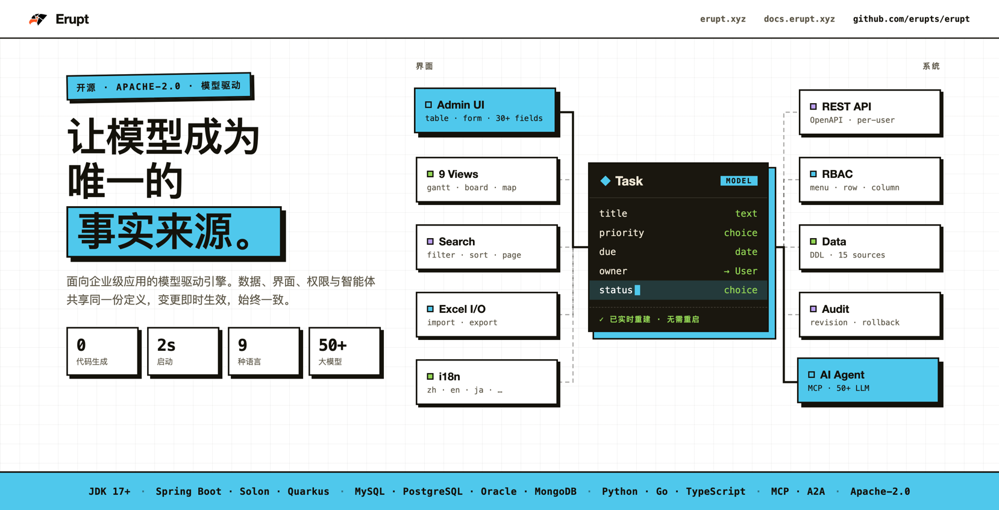
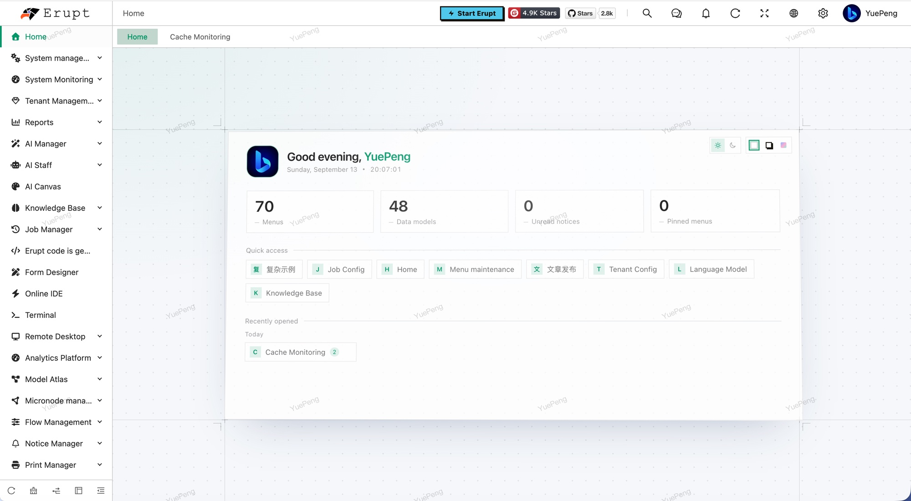
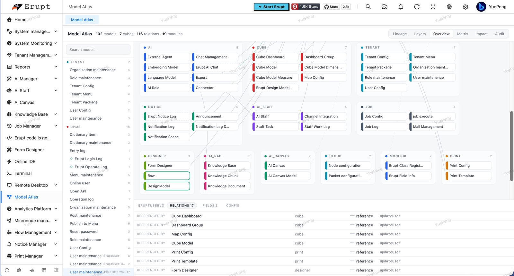
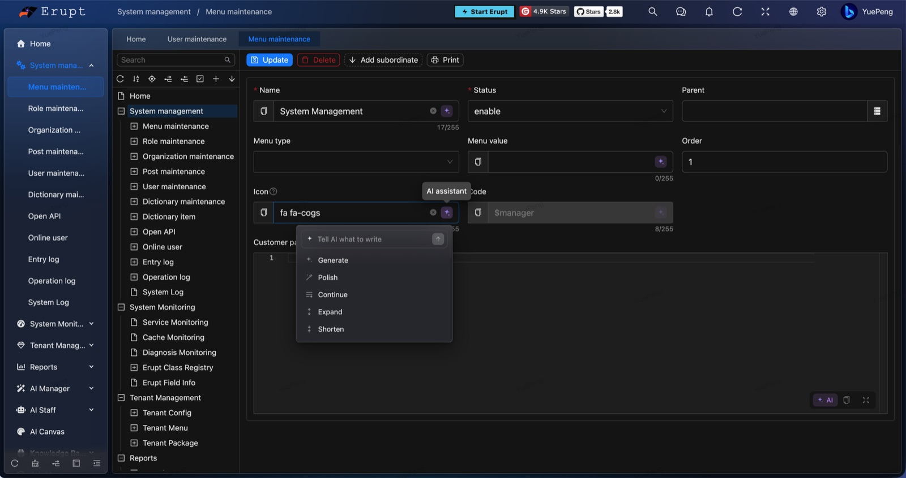
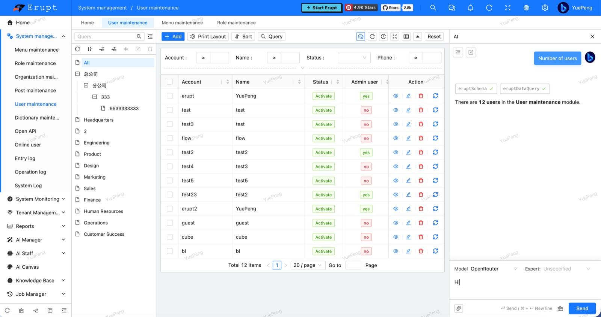

中文 &nbsp;|&nbsp; [English](README.md)

---

<p align="center">
  <picture>
    <source media="(prefers-color-scheme: dark)" srcset="readme/logo2.svg">
    
  </picture>
</p>

<h1 align="center">ERUPT</h1>

<p align="center"><b>模型驱动的企业级应用引擎 · AI HARNESS</b></p>

<p align="center"><code>让模型成为唯一的事实来源 · 运行时构建，而非代码生成 · 零前端 · 9 种语言 · 50+ 大模型 · MCP · A2A</code></p>

<p align="center">
  <a href="https://mvnrepository.com/search?q=erupt"></a>
  <a href="https://adoptium.net"></a>
  <a href="./LICENSE"></a>
  <a href="https://github.com/erupts/erupt"></a>
  <a href="https://github.com/erupts/erupt/releases"></a>
  <a href="https://github.com/erupts/erupt/actions/workflows/maven.yml"></a>
  <a href="https://app.codecov.io/github/erupts/erupt"></a>
  <a href="https://hub.docker.com/r/erupts/erupt"></a>
  <a href="https://gitee.com/erupt/erupt"></a>
</p>

<p align="center">
  <a href="https://demo.erupt.xyz"><code><b>[ 在线体验 ]</b></code></a>&nbsp;&nbsp;
  <a href="https://start.erupt.xyz"><code><b>[ 创建项目 ]</b></code></a>&nbsp;&nbsp;
  <a href="https://skill.erupt.xyz"><code><b>[ AI 技能 ]</b></code></a>&nbsp;&nbsp;
  <a href="https://docs.erupt.xyz"><code><b>[ 文档 ]</b></code></a>&nbsp;&nbsp;
  <a href="https://www.erupt.xyz"><code><b>[ 官网 ]</b></code></a>
</p>

---

<p align="center"></p>

---

## 00 · 核心理念

> **让模型成为唯一的事实来源。** 只需描述一次业务对象——字段、类型、关系与规则——Erupt 就在运行时据此构建出整个系统。没有生成的代码，也就不会产生偏差：改动模型，界面、接口、权限与数据层随之即时生效。

```
              ┌──────────────────────────────────────────┐
              │ Task                              model  │
              │ title  · text      priority · choice     │
              │ due    · date      owner    · → User     │
              └─────────────────────┬────────────────────┘
                                    │   read at runtime — nothing is generated
      ┌───────────┬───────────┬─────┴─────┬───────────┬───────────┐
      ▼           ▼           ▼           ▼           ▼           ▼
   Admin UI    REST API      RBAC        Data       Audit      AI Agent
   9 views     OpenAPI    row · col   15 sources   revision      MCP
```

| 模型构建出的能力 | 不必再写的代码 |
|---|---|
| `表格 · 表单` —— 30+ 字段组件 | ~~html · js · css~~ |
| `搜索 · 排序 · 分页` | ~~查询代码~~ |
| `REST · OPENAPI` —— 自带权限 | ~~Controller~~ |
| `DATAPROXY` —— 生命周期钩子 | ~~Service~~ |
| `自动建表` | ~~DDL · Mapper~~ |
| `RBAC` —— 菜单 · 行 · 列 · 按钮 | ~~权限代码~~ |
| `行操作` —— 支持表单与确认 | ~~操作接口~~ |
| `EXCEL 导入导出` | ~~POI 胶水代码~~ |
| `9 种视图` —— 表格 · 甘特 · 看板 · 日历 · 时间线 · 地图 · 卡片 … | ~~自定义页面~~ |
| `修订历史` —— 字段级变更与回滚 | ~~历史表~~ |
| `国际化` | ~~*.properties~~ |
| `AI 工具 · MCP` —— 每个模型都可被智能体操作 | ~~tool 胶水代码~~ |

---

## 01 · 为什么选 ERUPT

|                  | |
|------------------|---|
| `运行时，而非代码生成` | 模型在运行时被解析。没有需要维护的生成代码，也没有模板漂移——改模型，系统随之而变。 |
| `极速`           | 2~5 秒起一个完整系统。Java 17 + Spring Boot 3.x。 |
| `开箱即用`        | 登录、用户、角色、菜单、审计、Excel、OpenAPI、30+ 组件，上线即可用于生产。 |
| `AI 原生`        | 50+ 大模型、MCP 原生工具、A2A、70 万+ Skills。每个模型都能被智能体查询与操作。 |
| `任意数据源`      | JPA（MySQL · PostgreSQL · Oracle · SQL Server · 达梦）· JDBC · MongoDB · Elasticsearch · Redis · S3 · HTTP · 文件 · LDAP · Kubernetes · 飞书 · 钉钉 · Notion · Airtable。 |
| `任意框架`        | 不绑定 Spring：同一份模型可运行在 Spring Boot、Solon、Quarkus、Micronaut、Vert.x、Ktor 或任意 Servlet 容器。 |
| `任意语言`        | Python、Go、TypeScript、PHP、.NET、Rust、Ruby、Swift 服务通过 [erupt-sdk](https://github.com/plinian/erupt-sdk) 作为节点接入——同一套后台，同一套权限。 |
| `核心永久免费`     | Apache 2.0，永久开源。Flow / SaaS / Cube 商业模块按需选用。 |

---

## 02 · 快速开始

### A — 源码启动

克隆并运行内置示例。内嵌 H2，无需配置。

```bash
git clone https://github.com/erupts/erupt.git
cd erupt
mvn spring-boot:run -pl erupt-sample -am
# → http://localhost:8080   登录：erupt / erupt
```

### B — DOCKER

全家桶镜像 —— [hub.docker.com/r/erupts/erupt](https://hub.docker.com/r/erupts/erupt)。基于 `erupt-spring-boot-starter-all` 构建：designer、job、monitor、magic-api、notice、AI、cloud-server、内嵌 H2。零配置启动。

```bash
docker run -p 8080:8080 erupts/erupt
# → http://localhost:8080   登录：erupt / erupt
```

生产环境：通过 `-e` 环境变量切换 MySQL / Redis —— [镜像使用说明 →](./deploy/erupt-docker/README.md)

### C — MAVEN

**1 · 加一个依赖。**

```xml
<dependency>
    <groupId>xyz.erupt</groupId>
    <artifactId>erupt-spring-boot-starter</artifactId>
    <version>${erupt.version}</version>
</dependency>
```

这一个 starter 已包含跑起来一个 admin 所需的全部依赖（`erupt-admin` + `erupt-web`）。想要全部可选模块（designer、job、generator、monitor、magic-api、websocket、notice、print、terminal、AI、cloud-server）？改用 `erupt-spring-boot-starter-all`。

**2 · 描述模型。这就是整个系统。**

```java
@Erupt(name = "用户")
@Entity
public class User extends BaseModel {

    @EruptField(
        views = @View(title = "姓名"),
        edit  = @Edit(title = "姓名", search = @Search)
    )
    private String name;
}
```

**3 · 启动。**

```bash
mvn spring-boot:run
# → http://localhost:8080   登录：erupt / erupt
```

分页、搜索、导出、行列权限，全都有了。加一个字段，刷新，立刻出现。

### D — 在线生成器

[start.erupt.xyz](https://start.erupt.xyz) —— 在浏览器里勾选模块，下载即可运行的项目。本地零配置。

### E — AI SKILL

[skill.erupt.xyz](https://skill.erupt.xyz) —— **无任何开发背景**也能构建完整管理后台，专为非研发岗位（运营、HR、产品、财务）设计：在 Claude Code 等 AI 工具里用一句话描述你要的系统，其余全部由技能搞定 —— JDK、数据库（H2）、登录、增删改查、搜索、Excel、权限开箱即用。只写实体类，UI 和接口由注解在运行时渲染，token 消耗仅为从零手写的 1/20。

```bash
git clone https://github.com/plinian/erupt-skill.git ~/.claude/skills/erupt-admin
```

然后对 Claude Code 说：`"帮我生成一个 CRM 管理后台"` → 系统直接跑起来。

> `零安装` —— [demo.erupt.xyz](https://demo.erupt.xyz)（`guest / guest`）
> `完整教程` —— [docs.erupt.xyz/guide/quick-start](https://docs.erupt.xyz/guide/quick-start)

<details>
<summary><b>更多 —— 滑块、Choice、自定义按钮、LambdaQuery</b></summary>

```java
@Erupt(
    name = "Simple",
    power = @Power(importable = true, export = true),
    rowOperation = @RowOperation(
        title = "自定义操作",
        mode = RowOperation.Mode.SINGLE,
        operationHandler = OperationHandlerImpl.class
    )
)
@Table(name = "t_simple")
@Entity
public class Simple extends BaseModel {

    @EruptField(
        views = @View(title = "文本"),
        edit  = @Edit(title = "文本", notNull = true, search = @Search)
    )
    private String input;

    @EruptField(
        views = @View(title = "日期"),
        edit  = @Edit(title = "日期", search = @Search)
    )
    private Date date;

    @EruptField(
        views = @View(title = "滑块"),
        edit  = @Edit(title = "滑块", type = EditType.SLIDER, search = @Search,
            sliderType = @SliderType(max = 90, markPoints = {0, 30, 60, 90}, dots = true))
    )
    private Integer slide;

    @EruptField(
        views = @View(title = "选择项"),
        edit  = @Edit(title = "选择项", type = EditType.CHOICE, search = @Search,
            choiceType = @ChoiceType(
                fetchHandler = SqlChoiceFetchHandler.class,
                fetchHandlerParams = "select id, name from e_upms_menu"
            ))
    )
    private Long choice;
}
```

类型安全的 LambdaQuery 链式查询：

```java
List<EruptUser> list = eruptDao.lambdaQuery(EruptUser.class)
        .like(EruptUser::getName, "e")
        .isNull(EruptUser::getWhiteIp)
        .in(EruptUser::getId, 1, 2, 3, 4)
        .ge(EruptUser::getCreateTime, "2023-01-01")
        .list();
```

更多场景 —— [erupt.xyz/#!/contrast](https://www.erupt.xyz/#!/contrast)

</details>

---

## 03 · 开箱即用

<p align="center"></p>

| | |
|---|---|
| `UI 自动生成` | 表格、表单、搜索、分页、树视图、甘特图、卡片视图、20+ 表单组件 —— 全部由 `@View` / `@Edit` / `@Search` 驱动。 |
| `权限管控 · UPMS` | 用户、角色、菜单、行级筛选、列级可见性。`@Filter` 上写 SpEL。OAuth2 / LDAP / SSO。 |
| `OPENAPI` | 每个 `@Erupt` 实体自动成为 REST 接口，权限规则与界面完全一致。 |
| `任意数据源` | 15 个数据模块——JPA 数据库、JDBC、MongoDB、Elasticsearch、Redis、S3、HTTP、文件、LDAP、Kubernetes 及飞书 / 钉钉等在线表格。 |
| `EXCEL` | 导入导出走 `erupt-excel`。自定义就覆盖 `DataProxy` 的 `excelImport` / `excelExport`。 |
| `AI HARNESS` | `erupt-ai` —— 50+ 大模型、MCP 原生工具、内置 RBAC。[→ 04](#04--ai-harness) |
| `AI 家族` | 基于 `erupt-ai` 的 Claw、RAG、Staff、Dev、Canvas、Decision 智能体。[→ 05](#05--ai-家族) |
| `集群` | `erupt-cloud` 任意语言节点。商业模块 `erupt-tenant` 提供完整 SaaS。[→ 06](#06--任意语言--cloud) |

> `该引入哪个 AI 模块？` —— 要原生 LLM / MCP 能力、自己写 agent，选 `erupt-ai`；想直接给 admin 装个开箱即用的 AI 助手，选 `erupt-ai-claw`（已传递依赖 `erupt-ai`，只需引这一个）。

全部模块 —— [07](#07--模块全景) · API 文档 —— [javadoc.erupt.xyz](https://javadoc.erupt.xyz)

### 模型图谱

> 所有 `@Erupt` 实体和它们之间的关系，直接由生成界面的那套注解画出来。不需要额外配置，模型存在，图就存在。

| | |
|---|---|
| `总览` | 按模块分组展示全部模型，一眼看清整个系统的结构。 |
| `层级` | 依赖有多深：整个系统站在什么之上，以及深度真正来自哪几条链。 |
| `血缘` · `矩阵` · `影响面` | 单个模型的上下游、模块间耦合热力图，以及改动一个模型会波及谁。 |
| `字段` · `权限` · `体检` | 全库字段拉平、`@Power` 与菜单按钮的对账，以及循环依赖、共用表、孤立模型的体检报告。 |

<table>
  <tr>
    <td width="50%"></td>
    <td width="50%"></td>
  </tr>
</table>

---

## 04 · AI HARNESS

> `erupt-ai` —— JVM 上的生产级 AI Agent。50+ 大模型 · MCP 原生 · 内置 RBAC · 角色级 system prompt · 会话历史。全部通过管理界面配置。零样板代码。

**为什么叫「HARNESS」** —— 把 AI 推到生产环境，需要的不只是 SDK：**治理**（RBAC）+ **互操作**（MCP）+ **可观测**（会话历史、Token 追踪）+ **运维友好**（管理界面配置）。四件事，一次配齐。

**支持的大模型** —— OpenAI · Claude · Gemini · DeepSeek · 通义千问 · 智谱 GLM · 豆包 · Moonshot · MiniMax · Mistral · Grok · Fireworks · Together · OpenRouter · Ollama（本地）—— 管理界面里随时热切换，共 50+ 个。

| | |
|---|---|
| `多模型切换` | 通过管理界面配置多个 LLM。无需修改代码即可切换。 |
| `流式输出 · SSE` | 实时逐 token 响应，可配置超时时间。 |
| `思考模型` | 原生支持推理模型（DeepSeek、Kimi-K2）。 |
| `MCP` | 接入任意 MCP 工具服务器。SSE & STDIO 传输。自动健康检查与重连。 |
| `A2A` | Agent 之间通过标准 A2A 协议互相调用。原生支持多 Agent 协作。 |
| `AI TOOLBOX` | 将任意 Spring Bean 暴露为 AI 工具 —— `@AiToolbox` + `@Tool`。 |
| `TOOL 安全` | 每个 AI 工具都受 `LLMRole` 管控。按角色白名单或回收，运行时生效，无需重启。 |
| `AGENTIC` | 自定义 Agent 的系统提示词、提示词列表、动态 Prompt 处理器，原生集成 MCP 工具。 |
| `会话历史` | 按用户隔离的对话会话，Token 用量追踪，支持软删除。 |
| `长期记忆` | 跨会话记忆持久化。重要决策自动写入记忆，下次会话自动加载。 |

```java
@AiToolbox
@Component
public class MyTools {

    @Tool("根据订单ID查询订单状态")
    public String getOrderStatus(String orderId) {
        return orderService.getStatus(orderId);
    }
}
```

LLM 提供商、MCP 服务器、Agent —— 全部通过内置管理界面配置。无需重启。

### 字段助手

> 生成表单里的任意文本字段都自带一个行内写作助手。无需接线，只要 schema 说这个字段是文本，它就在。

`生成` · `润色` · `续写` · `扩写` · `精简` —— 也可以直接告诉它怎么写。结果流式写回字段，一键撤销。

<table>
  <tr>
    <td width="50%"></td>
    <td width="50%"></td>
  </tr>
</table>

---

## 05 · AI 家族

### AI CLAW

> `erupt-ai-claw` —— 通过自然语言直接驱动服务器，像与同事对话一样简单。

| | |
|---|---|
| `模型操作` | 通过对话对任意 `@Erupt` 实体进行增删改查。 |
| `SHELL` | 用自然语言直接运行系统命令。 |
| `文件读写` | 读取和写入服务器文件。 |
| `浏览器` | 在 MCP 菜单中添加配置即可与浏览器交互。 |
| `SKILLS · 70 万+` | 兼容 [skills.sh](https://skills.sh) 70 万+ Skills。AI 自动匹配执行。支持动态创建 Skill。 |

Claw 与 AI Harness 共享同一套基于 Role 的 Tool 安全机制 —— 非管理员账号只能调用被白名单的工具。Skills 存放于 `~/.erupt/skills/`，也可在对话中动态创建。

### 更多智能体

| 模块 | 用途 |
|---|---|
| `erupt-ai-rag` | 知识库与检索增强生成——Qdrant / Milvus / 内存向量库、文档入库、Agentic RAG。 |
| `erupt-ai-staff` | 数字员工：绑定系统账号与岗位人设，按 Cron 定时执行任务并汇报。 |
| `erupt-ai-dev` | AI 软件交付：带 Git 仓库的项目、需求池，以及每个需求独立的 worktree 供编码智能体工作。 |
| `erupt-ai-canvas` | 用自然语言描述页面，大模型基于 Erupt REST API 生成独立页面，并作为菜单挂载。 |
| `erupt-ai-decision` | 结构化、可校准的 AI 判断（选择 / 打分 / 是否），业务代码可直接据此分支。 |

---

## 06 · 任意语言 · CLOUD

> `erupt-cloud` —— 用同一套模型驱动的后台管理**任意语言**的分布式服务。登录、菜单、权限全由 Server 代办；节点可以是 Spring Boot，也可以是 Python / Go / TypeScript / PHP / .NET / Rust / Ruby / Swift 进程，只需描述模型、读写数据。

```
┌────────────────────────────┐
│  erupt-cloud-server        │   中心控制台 · 登录 · 菜单 · 权限
│  配置 · 节点 · 拓扑          │
└──────────────┬─────────────┘
               │  注册 / 心跳 / 转发
   ┌───────────┼───────────┬───────────┐
   ▼           ▼           ▼           ▼
┌───────┐  ┌────────┐  ┌───────┐  ┌───────┐
│ Java  │  │ Python │  │  Go   │  │ TS …  │   9 种语言任选
│ node  │  │  node  │  │ node  │  │ node  │   节点只管模型与数据
└───────┘  └────────┘  └───────┘  └───────┘
```

```python
# pip install erupt-sdk  —— Python 服务即可成为 erupt 后台节点
from erupt import Field, Node, SqliteRepository, erupt

@erupt("Article")
class Article:
    id: int = Field(pk=True)
    title: str = Field("Title", search=True, not_null=True)

node = Node("blog", os.environ["ERUPT_ACCESS_TOKEN"], "http://erupt-server:8080")
node.register(Article, SqliteRepository("blog.db", "article"))
node.serve(port=9090)
```

| | |
|---|---|
| `多语言节点` | Java / Kotlin（Spring Boot · Solon · Quarkus · Micronaut · Vert.x · Ktor · Servlet）· Python · Go · TypeScript · PHP · .NET · Rust · Ruby · Swift —— 同一份协议、同一套一致性测试。[erupt-sdk →](https://github.com/plinian/erupt-sdk) |
| `配置中心` | 多维度：配置结构、节点、发布策略。实例按需同步。 |
| `轻依赖` | 对 Spring Boot / 微服务栈侵入极小。版本与 Erupt 主线保持一致。 |
| `拓扑` | 集群拓扑、调用关系、配置发布 —— 一个控制台看全。 |
| `集群内后台` | 每个业务服务都能挂载自己的 Erupt 后台。无需为每个子系统重复搭脚手架。 |
| `审计` | 每次配置变更都有迹可循。比版本级回滚更细粒度。 |

[docs.erupt.xyz/modules/erupt-cloud](https://docs.erupt.xyz/modules/erupt-cloud) · [erupt.xyz/#!/cloud](https://www.erupt.xyz/#!/cloud) · [erupt.xyz/#!/sdk](https://www.erupt.xyz/#!/sdk)

---

## 07 · 模块全景

> 一个内核，五十多个模块。每个都是一个依赖，共享同一套模型、权限与界面。

| 分组 | 模块 |
|---|---|
| `AI · 7` | `erupt-ai` · `ai-claw` · `ai-rag` · `ai-staff` · `ai-dev` · `ai-canvas` · `ai-decision` |
| `数据源 · 15` | `jpa` · `jdbc` · `mongodb` · `es` · `redis` · `s3` · `http` · `file` · `ldap` · `k8s` · `memory` · `feishu` · `dingtalk` · `notion` · `airtable` |
| `插件 · 19` | `job` · `monitor` · `notice` · `report` · `print` · `revision` · `comment` · `share` · `sso` · `webhook` · `config` · `file-center` · `terminal` · `remote` · `magic-api` · `designer` · `generator` · `atlas` · `template` |
| `平台` | `cloud` · `erupt-sdk`（9 种语言）· `excel` · `websocket` · `git` · UI 主题 `ant-design` / `element-plus` / `element-ui` · `docker` |
| `商业 · 3` | `flow` · `saas` · `cube` —— 见 [08](#08--商业模块) |

完整介绍 —— [erupt.xyz](https://www.erupt.xyz) · API 文档 —— [javadoc.erupt.xyz](https://javadoc.erupt.xyz)

---

## 08 · 商业模块

> `核心永久免费开源` —— `erupt-core` / `erupt-annotation` / `erupt-web` / `erupt-jpa` / `erupt-upms` / `erupt-ai` 等核心模块永久遵循 Apache 2.0 协议。无 License 限制 · 无项目数限制 · 无商用限制（[官方治理承诺 →](./.github/GOVERNANCE.md)）。商业模块是核心之外可选的企业级扩展，与开源核心独立演进。

| 模块 | 用途 | 文档 |
|---|---|---|
| `ERUPT FLOW` | 流程引擎 / 审批工作流 | [文档 →](https://docs.erupt.xyz/modules/pro/erupt-flow) |
| `ERUPT SAAS` | 多租户基建 | [文档 →](https://docs.erupt.xyz/modules/pro/erupt-tenant) |
| `ERUPT CUBE` | BI 平台（语义层 + 拖拽分析） | [文档 →](https://docs.erupt.xyz/modules/pro/erupt-cube) |

源码交付 · 一次买断 · 永久使用。

**[定价与购买 →](https://www.erupt.xyz/?utm_source=gitee&utm_medium=readme&utm_campaign=pro#!/pro)**

---

## 09 · 匿名统计

Erupt 会上报匿名使用统计 —— erupt 版本、已装模块、JDK、操作系统与数据库类型、Spring Boot 版本、时区 —— 用于指导兼容性与路线图决策。绝不上报业务数据、凭据、主机名或任何可定位身份的信息，请求失败静默处理，绝不阻塞启动。

关闭：`erupt.telemetry.enabled: false` 或环境变量 `ERUPT_TELEMETRY_DISABLED=1`；CI 环境自动跳过。

---

## 10 · 参与贡献

免费且开源。提交代码、反馈缺陷、交流想法、分享案例、撰写博客 —— 一切贡献都欢迎。

请先阅读[贡献指南](./.github/CONTRIBUTING.md)，然后提交 [Issue](https://github.com/erupts/erupt/issues) 或 [Pull Request](https://github.com/erupts/erupt/pulls)。

[](https://github.com/erupts/erupt/graphs/contributors)

> `觉得 Erupt 帮到了你？请给个 Star。` 开源不易，对项目成长帮助很大。

<a href="https://www.star-history.com/#erupts/erupt&Date" target="_blank">
 <picture>
   <source media="(prefers-color-scheme: dark)" srcset="https://api.star-history.com/svg?repos=erupts/erupt&type=Date&theme=dark" />
   <source media="(prefers-color-scheme: light)" srcset="https://api.star-history.com/svg?repos=erupts/erupt&type=Date" />
   
 </picture>
</a>

---

## 11 · LICENSE

[Apache 2.0](./LICENSE) —— 免费 · 开源 · 可商用 · 可二次开发。

<p align="right"><code>作者 — <a href="https://github.com/erupts">YuePeng</a> · <a href="mailto:erupts@126.com">erupts@126.com</a></code></p>
