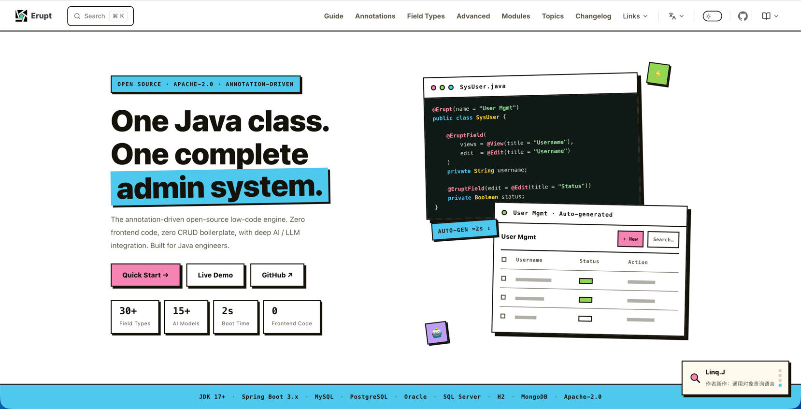

English &nbsp;|&nbsp; [中文](README-zh.md)

---

<p align="center">
  <picture>
    <source media="(prefers-color-scheme: dark)" srcset="readme/logo2.svg">
    
  </picture>
</p>

<h1 align="center">ERUPT</h1>

<h3 align="center">Write one Java class. Get a complete admin system.</h3>

<p align="center">Annotation-driven Java admin framework with a built-in AI harness.<br/>No controllers. No front-end. No scaffolding. Running in 2–5 seconds.</p>

<p align="center">
  <a href="https://mvnrepository.com/search?q=erupt"></a>
  <a href="https://adoptium.net"></a>
  <a href="./LICENSE"></a>
  <a href="https://github.com/erupts/erupt"></a>
  <a href="https://github.com/erupts/erupt/releases"></a>
  <a href="https://github.com/erupts/erupt/actions/workflows/maven.yml"></a>
  <a href="https://app.codecov.io/github/erupts/erupt"></a>
  <a href="https://hub.docker.com/r/erupts/erupt"></a>
  <a href="https://gitee.com/erupt/erupt"></a>
</p>

<p align="center">
  <a href="https://demo.erupt.xyz"><code><b>[ LIVE DEMO ]</b></code></a>&nbsp;&nbsp;
  <a href="#01--quickstart"><code><b>[ 30s QUICKSTART ]</b></code></a>&nbsp;&nbsp;
  <a href="https://docs.erupt.xyz"><code><b>[ DOCS ]</b></code></a>&nbsp;&nbsp;
  <a href="https://start.erupt.xyz"><code><b>[ START PROJECT ]</b></code></a>&nbsp;&nbsp;
  <a href="https://skill.erupt.xyz"><code><b>[ AI SKILL ]</b></code></a>&nbsp;&nbsp;
  <a href="https://www.erupt.xyz"><code><b>[ WEBSITE ]</b></code></a>
</p>

<p align="center"><sub>If Erupt saves you a week of CRUD, a <a href="https://github.com/erupts/erupt/stargazers">⭐ star</a> helps the next Java developer find it.</sub></p>

<p align="center"></p>

---

## 00 · THE 30-SECOND PITCH

**This class:**

```java
@Erupt(name = "Product", power = @Power(importable = true, export = true))
@Entity
public class Product extends BaseModel {

    @EruptField(views = @View(title = "Name"),
                edit  = @Edit(title = "Name", notNull = true, search = @Search))
    private String name;

    @EruptField(views = @View(title = "Price"),
                edit  = @Edit(title = "Price", search = @Search))
    private BigDecimal price;

    @EruptField(views = @View(title = "Launched"),
                edit  = @Edit(title = "Launched", search = @Search))
    private Date launchDate;
}
```

**…is the whole feature.** No controller, no service, no DTO, no Vue/React page. At runtime you get:

`PAGED TABLE` · `SEARCH FORM` · `CREATE / EDIT / DELETE` · `VALIDATION` · `EXCEL IMPORT & EXPORT` · `ROLE-BASED PERMISSIONS` · `AUDIT LOG` · `PERMISSION-AWARE REST API` · `AI WRITING ASSISTANT ON TEXT FIELDS`

Add a field, refresh the page, it is there.

| A typical admin page, by hand | The same page, with Erupt |
|---|---|
| Entity + Repository + Service + Controller + DTO | One annotated entity |
| Front-end page, form, table, routing, build pipeline | Rendered from annotations at runtime |
| Permission checks wired into every endpoint | Users, roles, menus, row and column rules built in |
| Excel, audit log, search, pagination written again | On by default, toggled per entity |
| Repeat for every table | Repeat for every table — in a few lines |

> Entities stay plain JPA. Remove the annotations and your domain model still compiles and runs — no lock-in.

---

## 01 · QUICKSTART

**Fastest — Docker, zero config:**

```bash
docker run -p 8080:8080 erupts/erupt
# → http://localhost:8080   login: erupt / erupt
```

All-in-one image with designer, job, monitor, magic-api, notice, AI and cloud-server on embedded H2. For MySQL / Redis in production see the [image guide →](./erupt-deploy/erupt-docker/README.md)

**In your Spring Boot app — one dependency:**

```xml
<dependency>
    <groupId>xyz.erupt</groupId>
    <artifactId>erupt-spring-boot-starter</artifactId>
    <version>${erupt.version}</version>
</dependency>
```

Annotate an entity like the one above, run `mvn spring-boot:run`, open `http://localhost:8080` (`erupt / erupt`). Want every optional module (designer, job, generator, monitor, magic-api, websocket, notice, print, terminal, AI, cloud-server)? Use `erupt-spring-boot-starter-all`.

<details>
<summary><b>More ways to start — source, online starter, AI skill, no-install demo</b></summary>

**From source** — H2 in-memory, no config:

```bash
git clone https://github.com/erupts/erupt.git
cd erupt
mvn spring-boot:run -pl erupt-sample -am
```

**Online starter** — [start.erupt.xyz](https://start.erupt.xyz): pick modules in the browser, download a ready-to-run project.

**AI skill** — [skill.erupt.xyz](https://skill.erupt.xyz): describe a system in one sentence inside Claude Code or a similar agent and get a running admin — JDK, H2, login, CRUD, search, Excel and permissions included. Only entities get written, so it costs about 1/20 of the tokens of generating a full stack. Made for non-engineers too (ops, HR, product, finance).

```bash
git clone https://github.com/plinian/erupt-skill.git ~/.claude/skills/erupt-admin
# then tell Claude Code: "Build me a CRM admin panel"
```

**No install** — [demo.erupt.xyz](https://demo.erupt.xyz) (`guest / guest`) · **Full guide** — [docs.erupt.xyz/guide/quick-start](https://docs.erupt.xyz/guide/quick-start)

</details>

---

## 02 · WHY DEVELOPERS PICK ERUPT

| | |
|---|---|
| `ONE CLASS = ONE PAGE` | Tables, forms, trees, cards, Gantt and 30+ field components — date, slider, code editor, reference table, map, signature, Markdown — driven by `@View` / `@Edit` / `@Search`. |
| `FAST` | Java 17 + Spring Boot 3. 2–5 seconds from `run` to a working UI. No front-end build. |
| `SECURE BY DEFAULT` | RBAC, menus, row-level filters (SpEL), column visibility, OAuth2 / LDAP / SSO, audit logs. The REST API obeys the same rules as the UI. |
| `ANY DATA SOURCE` | JPA on MySQL · PostgreSQL · Oracle · SQL Server · DM, plus connectors for MongoDB, JDBC, HTTP, Elasticsearch, Redis, S3, LDAP, Kubernetes, files, Feishu, DingTalk, Notion, Airtable. |
| `AI-NATIVE` | 50+ LLM providers, MCP tools, A2A agents, role-gated tool access — configured from the admin UI, not code. |
| `ESCAPE HATCHES` | `DataProxy` lifecycle hooks, custom row operations, choice / filter / power handlers, type-safe `LambdaQuery`, custom pages via templates. |
| `FREE FOREVER` | Apache 2.0 core. No project limits, no commercial restrictions. |

<details>
<summary><b>Show me more code — sliders, choices, custom actions, LambdaQuery</b></summary>

```java
@Erupt(
    name = "Simple",
    power = @Power(importable = true, export = true),
    rowOperation = @RowOperation(
        title = "Custom Action",
        mode = RowOperation.Mode.SINGLE,
        operationHandler = OperationHandlerImpl.class
    )
)
@Table(name = "t_simple")
@Entity
public class Simple extends BaseModel {

    @EruptField(
        views = @View(title = "Slider"),
        edit  = @Edit(title = "Slider", type = EditType.SLIDER, search = @Search,
            sliderType = @SliderType(max = 90, markPoints = {0, 30, 60, 90}, dots = true))
    )
    private Integer slide;

    @EruptField(
        views = @View(title = "Choice"),
        edit  = @Edit(title = "Choice", type = EditType.CHOICE, search = @Search,
            choiceType = @ChoiceType(
                fetchHandler = SqlChoiceFetchHandler.class,
                fetchHandlerParams = "select id, name from e_upms_menu"
            ))
    )
    private Long choice;
}
```

Type-safe queries, no strings:

```java
List<EruptUser> list = eruptDao.lambdaQuery(EruptUser.class)
        .like(EruptUser::getName, "e")
        .isNull(EruptUser::getWhiteIp)
        .in(EruptUser::getId, 1, 2, 3, 4)
        .ge(EruptUser::getCreateTime, "2023-01-01")
        .list();
```

More scenarios — [erupt.xyz/#!/contrast](https://www.erupt.xyz/#!/contrast)

</details>

---

## 03 · WHAT YOU GET OUT OF THE BOX

<p align="center"></p>

| | |
|---|---|
| `UI GENERATION` | Tables, forms, search, pagination, tree, card and Gantt views from annotations. |
| `UPMS` | Users, roles, menus, organizations, posts, dictionaries, row and column permissions, operation logs. |
| `OPENAPI` | Every `@Erupt` entity is a REST endpoint, governed by the UI's permission rules. |
| `EXCEL` | Import / export via `erupt-excel`, overridable on `DataProxy`. |
| `PLUGINS` | Report, designer, job scheduler, code generator, monitor, magic-api, notice, print, terminal, comments, revisions, webhooks, SSO, file center, config. |
| `MODEL ATLAS` | A live map of every model and relation, drawn from the same annotations — overview, layers, lineage, impact, permission audit. |

<table>
  <tr>
    <td width="50%"></td>
    <td width="50%"></td>
  </tr>
</table>

Module catalog — [erupt.xyz/#!/module](https://www.erupt.xyz/#!/module) · API reference — [javadoc.erupt.xyz](https://javadoc.erupt.xyz)

---

## 04 · AI HARNESS

> Shipping AI to production needs more than an SDK: **governance** (RBAC) + **interoperability** (MCP, A2A) + **observability** (chat history, token tracking) + **operator-friendly config** (admin UI). `erupt-ai` gives you all four.

**PROVIDERS** — OpenAI · Claude · Gemini · DeepSeek · Qwen · GLM · Doubao · Moonshot · MiniMax · Mistral · Grok · Fireworks · Together · OpenRouter · Ollama — hot-swappable from the admin UI, 50+ total.

Turn any Spring bean into an AI tool:

```java
@AiToolbox
@Component
public class OrderTools {

    @Tool("Look up order status by order ID")
    public String getOrderStatus(String orderId) {
        return orderService.getStatus(orderId);
    }
}
```

| | |
|---|---|
| `MCP · A2A` | Any MCP tool server over SSE or STDIO, with health checks. Agents call agents through A2A. |
| `TOOL SECURITY` | Every tool gated by `LLMRole`. Grant or revoke per role at runtime, no restart. |
| `STREAMING · THINKING` | Token-by-token SSE, native reasoning-model support. |
| `MEMORY` | Per-user chat history, token tracking, long-term cross-session memory. |
| `FIELD ASSISTANT` | Every text field in every generated form gets generate / polish / continue / expand / shorten, streamed in, one-click undo. |
| `AI CLAW` | `erupt-ai-claw` — operate your entities, shell, files and browser in natural language, with 700k+ compatible skills from [skills.sh](https://skills.sh). |

<table>
  <tr>
    <td width="50%"></td>
    <td width="50%"></td>
  </tr>
</table>

> `WHICH AI MODULE?` — `erupt-ai` for raw LLM / MCP access to build your own agent. `erupt-ai-claw` for a turn-key admin agent (it depends on `erupt-ai`; add only this one).

---

## 05 · CLOUD — ONE CONSOLE, MANY SERVICES

> `erupt-cloud` brings the same `@Erupt` model to distributed deployments: a central console for config, nodes and topology, and an admin UI inside every service.

```
┌────────────────────────────┐
│  erupt-cloud-server        │   central console
│  config · nodes · topology │
└──────────────┬─────────────┘
               │  register / pull config
   ┌───────────┼───────────┐
   ▼           ▼           ▼
┌───────┐  ┌───────┐  ┌───────┐
│ node  │  │ node  │  │ node  │   erupt-cloud-node
│ + own │  │ + own │  │ + own │   per-service admin UI
│ admin │  │ admin │  │ admin │
└───────┘  └───────┘  └───────┘
```

Nodes run on Spring Boot, or without Spring on Solon, Quarkus, Micronaut, Vert.x, Ktor and plain Servlet. Non-Java services join through [erupt-sdk](https://github.com/erupt-io/erupt-sdk). Config changes are audited and roll back finer than version level.

[docs.erupt.xyz/modules/erupt-cloud](https://docs.erupt.xyz/modules/erupt-cloud) · [erupt.xyz/#!/cloud](https://www.erupt.xyz/#!/cloud)

---

## 06 · FAQ

<details>
<summary><b>Is it really free for commercial use?</b></summary>

Yes. The core (`erupt-core`, `erupt-annotation`, `erupt-web`, `erupt-jpa`, `erupt-upms`, `erupt-ai` and other core modules) is Apache 2.0 forever — no project-count limits, no commercial restrictions. See the [governance commitment](./.github/GOVERNANCE.md).

</details>

<details>
<summary><b>What if annotations aren't enough?</b></summary>

Hook into every stage with `DataProxy` (before / after add, update, delete, fetch, search, import, export), add custom row operations and handlers, query with `LambdaQuery`, and drop in your own pages through the template engine (Ant Design, Element UI, Element Plus).

</details>

<details>
<summary><b>Am I locked in?</b></summary>

No. Your entities are standard JPA classes. The annotations only describe the UI; remove them and the domain model keeps working with any Spring Boot code.

</details>

<details>
<summary><b>Which databases and Java versions?</b></summary>

Java 17+ and Spring Boot 3. MySQL, PostgreSQL, Oracle, SQL Server, DM and H2 through JPA; MongoDB and more than a dozen other sources through `erupt-data` connectors.

</details>

---

## 07 · COMMERCIAL MODULES

Optional enterprise extensions, evolving independently of the free core.

| MODULE | USE CASE | DOCS |
|---|---|---|
| `ERUPT FLOW` | Workflow / approval engine | [docs →](https://docs.erupt.xyz/modules/pro/erupt-flow) |
| `ERUPT SAAS` | Multi-tenant infrastructure | [docs →](https://docs.erupt.xyz/modules/pro/erupt-tenant) |
| `ERUPT CUBE` | BI platform with semantic layer | [docs →](https://docs.erupt.xyz/modules/pro/erupt-cube) |

Source-code delivery · one-time purchase · perpetual use — **[PRICING & PURCHASE →](https://www.erupt.xyz/?utm_source=github&utm_medium=readme&utm_campaign=pro#!/pro)**

---

## 08 · TELEMETRY

Erupt reports anonymous usage statistics — erupt version, installed modules, JDK, OS and database type, Spring Boot version, timezone — to guide compatibility and roadmap decisions. It never sends business data, credentials, hostnames, or anything IP-derived, and requests fail silently without ever blocking startup.

Opt out with `erupt.telemetry.enabled: false` or the `ERUPT_TELEMETRY_DISABLED=1` environment variable; CI is skipped automatically.

---

## 09 · COMMUNITY & CONTRIBUTING

Code, bug reports, ideas, use cases, blog posts — all welcome. Read the [contribution guidelines](./.github/CONTRIBUTING.md), then open an [issue](https://github.com/erupts/erupt/issues) or [pull request](https://github.com/erupts/erupt/pulls).

[](https://github.com/erupts/erupt/graphs/contributors)

### ⭐ STAR ERUPT

Stars are how Java developers discover Erupt. If it saved you time — or you want to follow where the AI harness goes next — **[give it a star](https://github.com/erupts/erupt/stargazers)**. It takes one click and genuinely keeps the project moving.

<a href="https://star-history.dera.page/#erupts/erupt&type=date&legend=top-left" target="_blank">
 <picture>
   <source media="(prefers-color-scheme: dark)" srcset="https://star-history.dera.page/svg?repos=erupts/erupt&type=date&theme=dark&legend=top-left" />
   <source media="(prefers-color-scheme: light)" srcset="https://star-history.dera.page/svg?repos=erupts/erupt&type=date&legend=top-left" />
   
 </picture>
</a>

---

## 10 · LICENSE


[Apache 2.0](./LICENSE) — free · open source · commercial use permitted · fork-friendly.

<p align="right"><code>AUTHOR — <a href="https://github.com/erupts">YuePeng</a> · <a href="mailto:erupts@126.com">erupts@126.com</a></code></p>
