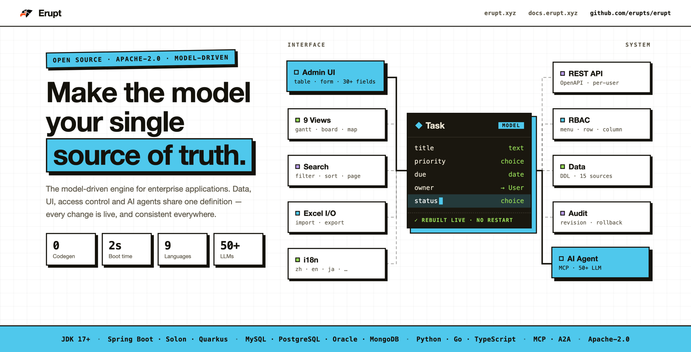
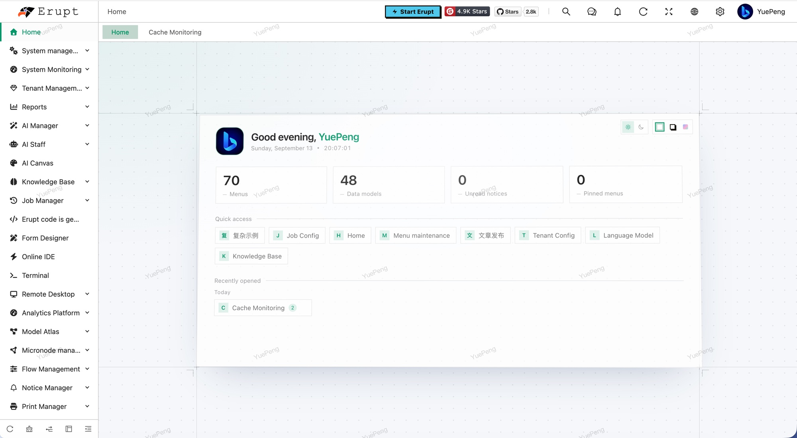
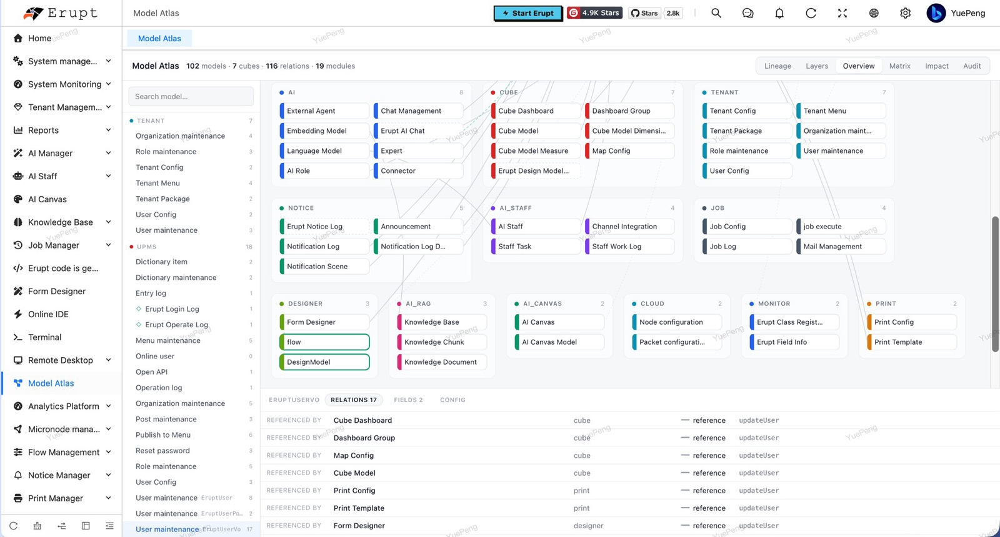
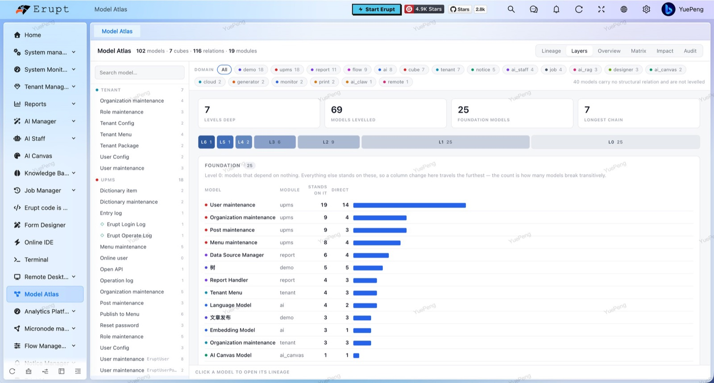
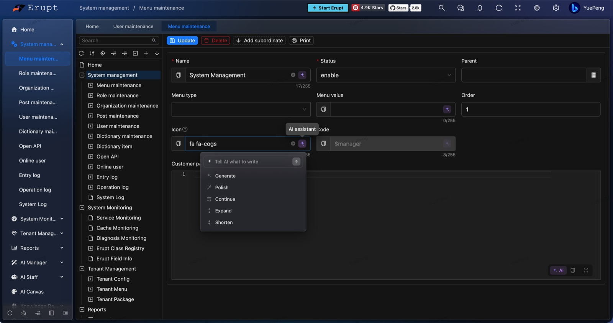
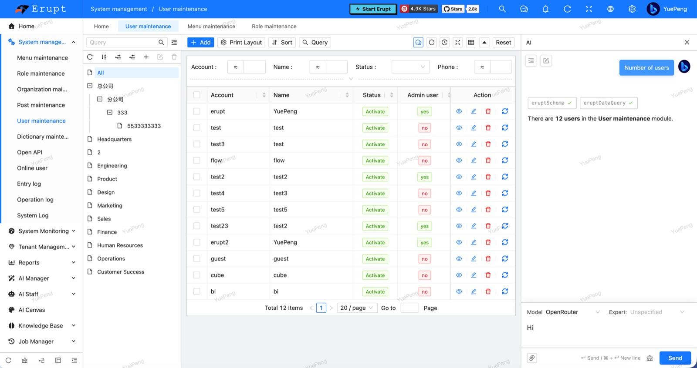
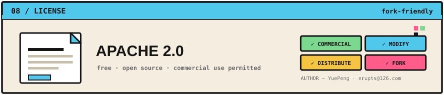

English &nbsp;|&nbsp; [中文](README-zh.md)

---

<p align="center">
  <picture>
    <source media="(prefers-color-scheme: dark)" srcset="readme/logo2.svg">
    
  </picture>
</p>

<h1 align="center">ERUPT</h1>

<p align="center"><b>MODEL-DRIVEN ENGINE FOR ENTERPRISE APPLICATIONS · AI HARNESS</b></p>

<p align="center"><code>make the model your single source of truth · built at runtime, not generated · zero front-end · 9 languages · 50+ LLM · MCP · A2A</code></p>

<p align="center">
  <a href="https://mvnrepository.com/search?q=erupt"></a>
  <a href="https://adoptium.net"></a>
  <a href="./LICENSE"></a>
  <a href="https://github.com/erupts/erupt"></a>
  <a href="https://github.com/erupts/erupt/releases"></a>
  <a href="https://github.com/erupts/erupt/actions/workflows/maven.yml"></a>
  <a href="https://app.codecov.io/github/erupts/erupt"></a>
  <a href="https://hub.docker.com/r/erupts/erupt"></a>
  <a href="https://gitee.com/erupt/erupt"></a>
</p>

<p align="center">
  <a href="https://www.erupt.xyz"><code><b>[ WEBSITE ]</b></code></a>&nbsp;&nbsp;
  <a href="https://demo.erupt.xyz"><code><b>[ LIVE DEMO ]</b></code></a>&nbsp;&nbsp;
  <a href="https://start.erupt.xyz"><code><b>[ START PROJECT ]</b></code></a>&nbsp;&nbsp;
  <a href="https://skill.erupt.xyz"><code><b>[ AI SKILL ]</b></code></a>&nbsp;&nbsp;
  <a href="https://docs.erupt.xyz"><code><b>[ DOCS ]</b></code></a>
</p>

---

<p align="center"></p>

---

## 00 · THE IDEA

> **Make the model your single source of truth.** Describe a business object once — its fields, types, relations and rules — and Erupt builds the rest of the system from it at runtime. Nothing is generated, so nothing drifts: change the model, and the UI, APIs, permissions and data layer change with it, instantly.

```
                 ┌──────────────────────────┐
  Admin UI  ◄────┤                          ├────►  REST · OpenAPI
  9 views   ◄────┤   ◆ Task          model  ├────►  RBAC · row / column
  Search    ◄────┤   title     text         ├────►  Data · DDL · 15 sources
  Excel I/O ◄────┤   priority  choice       ├────►  Audit · revision
  i18n      ◄────┤   due       date         ├────►  AI agent · MCP
                 │   owner     → User       │
                 └──────────────────────────┘
           one model  →  the whole system, rebuilt live on every change
```

| WHAT THE MODEL BUILDS | WHAT YOU NO LONGER WRITE |
|---|---|
| `TABLE · FORM` — 30+ field components | ~~html · js · css~~ |
| `SEARCH · SORT · PAGE` | ~~query code~~ |
| `REST · OPENAPI` — permission-aware | ~~Controller~~ |
| `DATAPROXY` — lifecycle hooks | ~~Service~~ |
| `AUTO DDL` | ~~DDL · Mapper~~ |
| `RBAC` — menu · row · column · button | ~~permission code~~ |
| `ROW ACTIONS` — with forms and confirm | ~~action endpoints~~ |
| `EXCEL I/O` | ~~POI glue~~ |
| `9 VIEWS` — table · gantt · board · calendar · timeline · map · card … | ~~custom pages~~ |
| `REVISION` — field-level history, rollback | ~~history tables~~ |
| `I18N` | ~~*.properties~~ |
| `AI TOOLS · MCP` — every model is agent-operable | ~~tool glue~~ |

---

## 01 · WHY ERUPT

|                          | |
|--------------------------|---|
| `RUNTIME, NOT CODEGEN`   | The model is read at runtime. No generated code to maintain, no template drift — edit the model and the system follows. |
| `FAST`                   | 2–5 seconds to a running system. Java 17 + Spring Boot 3.x. |
| `BATTERIES INCLUDED`     | Login, users, roles, menus, audit, Excel, OpenAPI, 30+ components — production-ready on day one. |
| `AI-NATIVE`              | 50+ LLM providers, MCP-native tools, A2A, 700k+ skills. Every model is something an agent can query and operate. |
| `ANY DATA SOURCE`        | JPA (MySQL · PostgreSQL · Oracle · SQL Server · DM) · JDBC · MongoDB · Elasticsearch · Redis · S3 · HTTP · files · LDAP · Kubernetes · Feishu · DingTalk · Notion · Airtable. |
| `ANY FRAMEWORK`          | Not tied to Spring: the same model runs on Spring Boot, Solon, Quarkus, Micronaut, Vert.x, Ktor or any servlet container. |
| `ANY LANGUAGE`           | Python, Go, TypeScript, PHP, .NET, Rust, Ruby and Swift services join as [erupt-sdk](https://github.com/plinian/erupt-sdk) nodes — same admin, same permissions. |
| `FREE CORE`              | Apache 2.0, forever. Commercial Flow / SaaS / Cube modules are optional. |

---

## 02 · QUICKSTART

### A — SOURCE

Clone and run the bundled sample. H2 in-memory. No config.

```bash
git clone https://github.com/erupts/erupt.git
cd erupt
mvn spring-boot:run -pl erupt-sample -am
# → http://localhost:8080   login: erupt / erupt
```

### B — DOCKER

All-in-one image — [hub.docker.com/r/erupts/erupt](https://hub.docker.com/r/erupts/erupt). Built on `erupt-spring-boot-starter-all`: designer, job, monitor, magic-api, notice, AI, cloud-server, embedded H2. Zero configuration.

```bash
docker run -p 8080:8080 erupts/erupt
# → http://localhost:8080   login: erupt / erupt
```

Production: switch to MySQL / Redis via `-e` env vars — [image guide →](./deploy/erupt-docker/README.md)

### C — MAVEN

**1 · One dependency.**

```xml
<dependency>
    <groupId>xyz.erupt</groupId>
    <artifactId>erupt-spring-boot-starter</artifactId>
    <version>${erupt.version}</version>
</dependency>
```

Bundles everything a runnable admin needs (`erupt-admin` + `erupt-web`). Want every optional module too (designer, job, generator, monitor, magic-api, websocket, notice, print, terminal, AI, cloud-server)? Use `erupt-spring-boot-starter-all`.

**2 · Describe the model. This IS the system.**

```java
@Erupt(name = "User")
@Entity
public class User extends BaseModel {

    @EruptField(
        views = @View(title = "Name"),
        edit  = @Edit(title = "Name", search = @Search)
    )
    private String name;
}
```

**3 · Run.**

```bash
mvn spring-boot:run
# → http://localhost:8080   login: erupt / erupt
```

Paged. Searchable. Exportable. Role-gated. Add a field, refresh, it shows up.

### D — STARTER

[start.erupt.xyz](https://start.erupt.xyz) — pick modules in your browser, download a ready-to-run project. No local setup.

### E — AI SKILL

[skill.erupt.xyz](https://skill.erupt.xyz) — build a full admin panel with **zero development background**. Made for non-engineering roles (ops, HR, product, finance): describe your system in one sentence inside Claude Code or a similar AI agent, and the skill handles the rest — JDK, database (H2), login, CRUD, search, Excel, permissions all included. Only entities get written; UI and APIs render from annotations at runtime, so it costs ~1/20 the tokens of writing from scratch.

```bash
git clone https://github.com/plinian/erupt-skill.git ~/.claude/skills/erupt-admin
```

Then tell Claude Code: `"Build me a CRM admin panel"` → running system.

> `NO INSTALL` — [demo.erupt.xyz](https://demo.erupt.xyz) (`guest / guest`)
> `FULL GUIDE` — [docs.erupt.xyz/guide/quick-start](https://docs.erupt.xyz/guide/quick-start)

<details>
<summary><b>MORE — sliders, choice fields, custom actions, LambdaQuery</b></summary>

```java
@Erupt(
    name = "Simple",
    power = @Power(importable = true, export = true),
    rowOperation = @RowOperation(
        title = "Custom Action",
        mode = RowOperation.Mode.SINGLE,
        operationHandler = OperationHandlerImpl.class
    )
)
@Table(name = "t_simple")
@Entity
public class Simple extends BaseModel {

    @EruptField(
        views = @View(title = "Text"),
        edit  = @Edit(title = "Text", notNull = true, search = @Search)
    )
    private String input;

    @EruptField(
        views = @View(title = "Date"),
        edit  = @Edit(title = "Date", search = @Search)
    )
    private Date date;

    @EruptField(
        views = @View(title = "Slider"),
        edit  = @Edit(title = "Slider", type = EditType.SLIDER, search = @Search,
            sliderType = @SliderType(max = 90, markPoints = {0, 30, 60, 90}, dots = true))
    )
    private Integer slide;

    @EruptField(
        views = @View(title = "Choice"),
        edit  = @Edit(title = "Choice", type = EditType.CHOICE, search = @Search,
            choiceType = @ChoiceType(
                fetchHandler = SqlChoiceFetchHandler.class,
                fetchHandlerParams = "select id, name from e_upms_menu"
            ))
    )
    private Long choice;
}
```

Type-safe queries with LambdaQuery:

```java
List<EruptUser> list = eruptDao.lambdaQuery(EruptUser.class)
        .like(EruptUser::getName, "e")
        .isNull(EruptUser::getWhiteIp)
        .in(EruptUser::getId, 1, 2, 3, 4)
        .ge(EruptUser::getCreateTime, "2023-01-01")
        .list();
```

More scenarios — [erupt.xyz/#!/contrast](https://www.erupt.xyz/#!/contrast)

</details>

---

## 03 · OUT OF THE BOX

<p align="center"></p>

| | |
|---|---|
| `UI GENERATION` | Tables, forms, search, pagination, tree views, Gantt, card views, 20+ field components — driven by `@View` / `@Edit` / `@Search`. |
| `PERMISSIONS · UPMS` | Users, roles, menus, row-level filters, column-level visibility. SpEL on `@Filter`. OAuth2 / LDAP / SSO. |
| `OPENAPI` | Every `@Erupt` entity is a REST endpoint, governed by the same permission rules as the UI. |
| `ANY DATA SOURCE` | 15 data modules — JPA databases, JDBC, MongoDB, Elasticsearch, Redis, S3, HTTP, files, LDAP, Kubernetes and SaaS tables. |
| `EXCEL` | Import/export via `erupt-excel`. Override `excelImport` / `excelExport` on `DataProxy`. |
| `AI HARNESS` | `erupt-ai` — 50+ LLM providers, MCP-native tools, built-in RBAC. [→ 04](#04--ai-harness) |
| `AI FAMILY` | Claw, RAG, Staff, Dev, Canvas and Decision agents on top of `erupt-ai`. [→ 05](#05--ai-family) |
| `CLUSTER` | `erupt-cloud` nodes in any language. Commercial `erupt-tenant` for full SaaS. [→ 06](#06--any-language--cloud) |

> `WHICH AI MODULE?` — Pick `erupt-ai` for raw LLM / MCP access to build your own agent. Pick `erupt-ai-claw` for a turn-key admin agent (it depends on `erupt-ai`; add only this one).

All modules — [07](#07--modules) · API reference — [javadoc.erupt.xyz](https://javadoc.erupt.xyz)

### MODEL ATLAS

> Every `@Erupt` entity, every relation between them, drawn from the same annotations that build the UI. No extra configuration — the map exists because the model does.

| | |
|---|---|
| `OVERVIEW` | Every model grouped by module. Read the shape of the whole system at a glance. |
| `LAYERS` | How deep the graph runs: what everything stands on, and the few chains the depth comes from. |
| `LINEAGE` · `MATRIX` · `IMPACT` | One model's neighbourhood, module-to-module coupling, and what breaks if a model changes. |
| `FIELDS` · `POWER` · `AUDIT` | Every field of every model, declared `@Power` against the menu buttons behind it, and a health report: cycles, shared tables, isolated models. |

<table>
  <tr>
    <td width="50%"></td>
    <td width="50%"></td>
  </tr>
</table>

---

## 04 · AI HARNESS

> `erupt-ai` — production-grade AI agents on JVM. 50+ LLM providers · MCP-native · built-in RBAC · role-aware system prompts · chat history. All configurable through the admin UI. Zero boilerplate.

**WHY "HARNESS"** — Shipping AI to production needs more than an SDK: **governance** (RBAC) + **interoperability** (MCP) + **observability** (chat history, token tracking) + **operator-friendly config** (admin UI). All four, out of the box.

**PROVIDERS** — OpenAI · Claude · Gemini · DeepSeek · Qwen · GLM · Doubao · Moonshot · MiniMax · Mistral · Grok · Fireworks · Together · OpenRouter · Ollama (self-hosted) — hot-swappable from the admin UI, 50+ total.

| | |
|---|---|
| `MULTI-PROVIDER` | Configure multiple LLMs via UI. Switch without code changes. |
| `STREAMING · SSE` | Token-by-token responses, configurable timeouts. |
| `THINKING MODELS` | Native support for reasoning models (DeepSeek, Kimi-K2). |
| `MCP` | Any MCP-compatible tool server. SSE & STDIO transports. Auto-reconnect health checks. |
| `A2A` | Agents call agents through the standardized A2A protocol. Multi-agent workflows out of the box. |
| `AI TOOLBOX` | Expose any Spring Bean as an AI tool — `@AiToolbox` + `@Tool`. |
| `TOOL SECURITY` | Every AI tool gated by `LLMRole`. Whitelist or revoke per role at runtime. No restart. |
| `AGENTIC` | Agents with custom system prompts, hint lists, dynamic prompt handlers, MCP tools. |
| `CHAT HISTORY` | Per-user sessions, token tracking, soft-delete. |
| `LONG-TERM MEMORY` | Cross-session persistence. Key decisions auto-stored, reloaded next session. |

```java
@AiToolbox
@Component
public class MyTools {

    @Tool("Look up order status by order ID")
    public String getOrderStatus(String orderId) {
        return orderService.getStatus(orderId);
    }
}
```

LLM providers, MCP servers, agents — all managed through the built-in admin UI. No restarts.

### FIELD ASSISTANT

> Any text field in any generated form gets an inline writing assistant. Nothing to wire up — it appears wherever the schema says the field holds text.

`GENERATE` · `POLISH` · `CONTINUE` · `EXPAND` · `SHORTEN` — or just tell it what to write. Streams into the field, and one click undoes it.

<table>
  <tr>
    <td width="50%"></td>
    <td width="50%"></td>
  </tr>
</table>

---

## 05 · AI FAMILY

### AI CLAW

> `erupt-ai-claw` — drive your server through natural language, like talking to a colleague.

| | |
|---|---|
| `MODEL OPS` | Query, create, update data across any `@Erupt` entity via chat. |
| `SHELL` | Run system commands through natural language. |
| `FILE I/O` | Read and write files on the server. |
| `BROWSER` | Interact with the browser via MCP configuration. |
| `SKILLS · 700K+` | Compatible with 700k+ skills from [skills.sh](https://skills.sh). AI auto-matches and executes. Dynamic skill creation supported. |

Claw shares the same role-based tool security as AI Harness — only whitelisted tools reach non-admin users. Skills live in `~/.erupt/skills/` and can also be created through chat.

### MORE AGENTS

| MODULE | WHAT IT DOES |
|---|---|
| `erupt-ai-rag` | Knowledge base and retrieval-augmented generation — Qdrant / Milvus / in-memory vector stores, document ingestion, agentic RAG. |
| `erupt-ai-staff` | Digital employees: an agent with a system account, a duty persona, cron-scheduled tasks and work reports. |
| `erupt-ai-dev` | AI software delivery: projects with git repositories, a requirement pool and per-requirement worktrees for coding agents. |
| `erupt-ai-canvas` | Describe a page in plain language; the LLM writes a self-contained page over the Erupt REST API, served as a menu. |
| `erupt-ai-decision` | Typed, calibrated judgements (choice / score / yes-no) that business code can branch on. |

---

## 06 · ANY LANGUAGE · CLOUD

> `erupt-cloud` — one model-driven admin for distributed services **in any language**. One server handles login, menus and permissions; each node — Spring Boot or a Python / Go / TypeScript / PHP / .NET / Rust / Ruby / Swift process — only describes its models and serves their data.

```
┌────────────────────────────┐
│  erupt-cloud-server        │   console · login · menus · RBAC
│  config · nodes · topology │
└──────────────┬─────────────┘
               │  register / heartbeat / forward
   ┌───────────┼───────────┬───────────┐
   ▼           ▼           ▼           ▼
┌───────┐  ┌────────┐  ┌───────┐  ┌───────┐
│ Java  │  │ Python │  │  Go   │  │ TS …  │   nodes in any of 9 languages
│ node  │  │  node  │  │ node  │  │ node  │   each owns its models + data
└───────┘  └────────┘  └───────┘  └───────┘
```

```python
# pip install erupt-sdk  — a Python service becomes an erupt admin node
from erupt import Field, Node, SqliteRepository, erupt

@erupt("Article")
class Article:
    id: int = Field(pk=True)
    title: str = Field("Title", search=True, not_null=True)

node = Node("blog", os.environ["ERUPT_ACCESS_TOKEN"], "http://erupt-server:8080")
node.register(Article, SqliteRepository("blog.db", "article"))
node.serve(port=9090)
```

| | |
|---|---|
| `POLYGLOT NODES` | Java / Kotlin (Spring Boot · Solon · Quarkus · Micronaut · Vert.x · Ktor · Servlet) · Python · Go · TypeScript · PHP · .NET · Rust · Ruby · Swift — one protocol, one conformance suite. [erupt-sdk →](https://github.com/plinian/erupt-sdk) |
| `CONFIG CENTER` | Multi-dimensional: schemas, nodes, rollout policies. Instances sync on demand. |
| `LIGHT` | Minimal intrusion. Versions aligned with the main Erupt release train. |
| `TOPOLOGY` | Cluster topology, call graphs, config rollouts — one console. |
| `IN-CLUSTER ADMIN` | Every business service hosts its own Erupt admin. No per-subsystem scaffolding. |
| `AUDIT` | Every config change leaves a trace. Finer-grained rollback than version-level. |

[docs.erupt.xyz/modules/erupt-cloud](https://docs.erupt.xyz/modules/erupt-cloud) · [erupt.xyz/#!/cloud](https://www.erupt.xyz/#!/cloud) · [erupt.xyz/#!/sdk](https://www.erupt.xyz/#!/sdk)

---

## 07 · MODULES

> One core, fifty-odd modules. Each is one dependency and shares the same model, permissions and UI.

| GROUP | MODULES |
|---|---|
| `AI · 7` | `erupt-ai` · `ai-claw` · `ai-rag` · `ai-staff` · `ai-dev` · `ai-canvas` · `ai-decision` |
| `DATA · 15` | `jpa` · `jdbc` · `mongodb` · `es` · `redis` · `s3` · `http` · `file` · `ldap` · `k8s` · `memory` · `feishu` · `dingtalk` · `notion` · `airtable` |
| `PLUGINS · 19` | `job` · `monitor` · `notice` · `report` · `print` · `revision` · `comment` · `share` · `sso` · `webhook` · `config` · `file-center` · `terminal` · `remote` · `magic-api` · `designer` · `generator` · `atlas` · `template` |
| `PLATFORM` | `cloud` · `erupt-sdk` (9 languages) · `excel` · `websocket` · `git` · UI themes `ant-design` / `element-plus` / `element-ui` · `docker` |
| `PRO · 3` | `flow` · `saas` · `cube` — see [08](#08--commercial-modules) |

Full list — [erupt.xyz](https://www.erupt.xyz) · API reference — [javadoc.erupt.xyz](https://javadoc.erupt.xyz)

---

## 08 · COMMERCIAL MODULES

> `CORE IS FREE, FOREVER` — `erupt-core` / `erupt-annotation` / `erupt-web` / `erupt-jpa` / `erupt-upms` / `erupt-ai` and other core modules are Apache 2.0 forever. No license restrictions · no project-count limits · no commercial restrictions ([governance commitment →](./.github/GOVERNANCE.md)). Commercial modules are optional enterprise extensions that evolve independently.

| MODULE | USE CASE | DOCS |
|---|---|---|
| `ERUPT FLOW` | Workflow / approval engine | [docs →](https://docs.erupt.xyz/modules/pro/erupt-flow) |
| `ERUPT SAAS` | Multi-tenant infrastructure | [docs →](https://docs.erupt.xyz/modules/pro/erupt-tenant) |
| `ERUPT CUBE` | BI platform with semantic layer | [docs →](https://docs.erupt.xyz/modules/pro/erupt-cube) |

Source-code delivery · one-time purchase · perpetual use.

**[PRICING & PURCHASE →](https://www.erupt.xyz/?utm_source=github&utm_medium=readme&utm_campaign=pro#!/pro)**

---

## 09 · TELEMETRY

Erupt reports anonymous usage statistics — erupt version, installed modules, JDK, OS and database type, Spring Boot version, timezone — to guide compatibility and roadmap decisions. It never sends business data, credentials, hostnames, or anything IP-derived, and requests fail silently without ever blocking startup.

Opt out with `erupt.telemetry.enabled: false` or the `ERUPT_TELEMETRY_DISABLED=1` environment variable; CI is skipped automatically.

---

## 10 · CONTRIBUTING

Free and open source. Code, bug reports, ideas, use cases, blog posts — all welcome.

Read the [contribution guidelines](./.github/CONTRIBUTING.md), then open an [issue](https://github.com/erupts/erupt/issues) or [pull request](https://github.com/erupts/erupt/pulls).

[](https://github.com/erupts/erupt/graphs/contributors)

> `IF ERUPT SAVES YOU TIME — STAR IT.` It really helps the project grow.

<a href="https://www.star-history.com/#erupts/erupt&Date" target="_blank">
 <picture>
   <source media="(prefers-color-scheme: dark)" srcset="https://api.star-history.com/svg?repos=erupts/erupt&type=Date&theme=dark" />
   <source media="(prefers-color-scheme: light)" srcset="https://api.star-history.com/svg?repos=erupts/erupt&type=Date" />
   
 </picture>
</a>

---

## 11 · LICENSE



[Apache 2.0](./LICENSE) — free · open source · commercial use permitted · fork-friendly.

<p align="right"><code>AUTHOR — <a href="https://github.com/erupts">YuePeng</a> · <a href="mailto:erupts@126.com">erupts@126.com</a></code></p>
